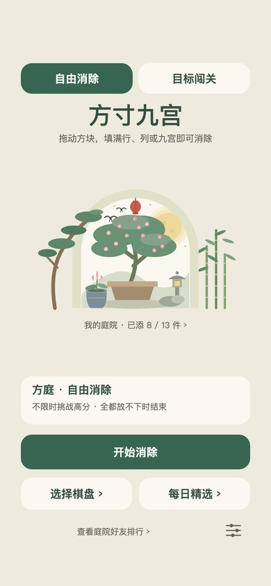
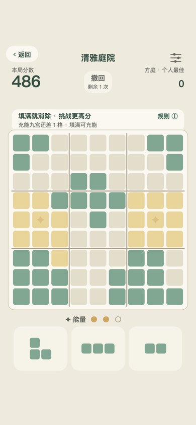
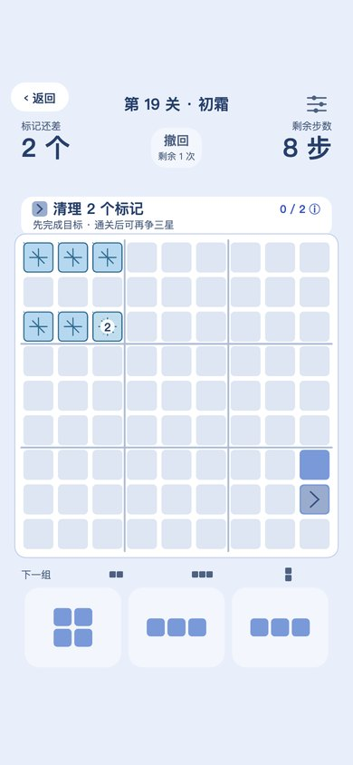
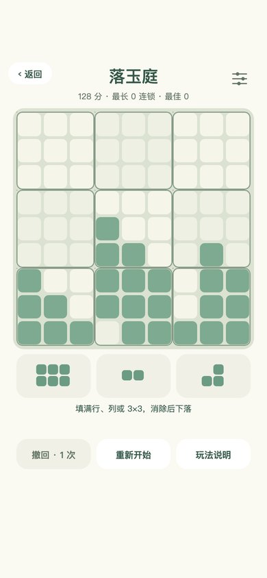
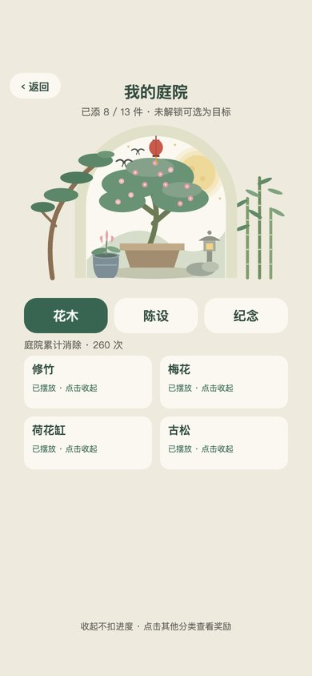
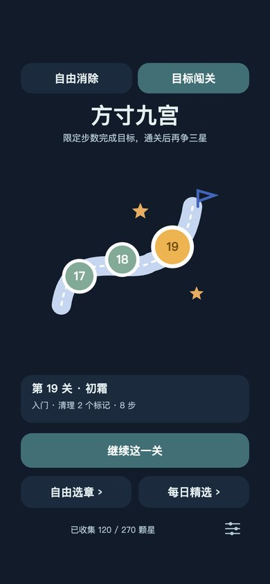

# Moongate Blocks

*方寸九宫 · Fangcun Jiugong*

A calm block-placement puzzle for **WeChat Mini Games**, set in a small Chinese courtyard behind a moon gate.
Drag pieces onto a 9×9 board and clear full rows, columns or 3×3 palaces.

**[▶ Play in your browser](https://jackhuangzihao.github.io/moongate-blocks/)**

[Gameplay](#gameplay) · [Browser preview](#browser-preview) · [Development guide](docs/development.md) · [Asset notes](docs/assets.md) · [License](#license) · [中文说明](#中文说明)

Plain JavaScript, CommonJS and Canvas 2D. The WeChat game needs no framework, package installation or build step. The optional browser preview is generated from the same sources.

<table>
  <tr>
    <td><br>Home · 庭院首页</td>
    <td><br>Free play · 自由消除</td>
    <td><br>Challenge · 目标闯关</td>
  </tr>
  <tr>
    <td><br>Gravity · 落玉庭</td>
    <td><br>Collection · 我的庭院</td>
    <td><br>Neon theme · 暗色霓虹</td>
  </tr>
</table>

## Gameplay

- **Free play (自由消除)** — three boards: an open 9×9, a blocked centre, and five star-point obstacles. Clear marked palaces to charge energy and earn a small lucky piece.
- **Challenge (目标闯关)** — 90 levels in five chapters, with fixed decks and move limits. Ice needs two clears; stones and gates add constraints. Finish in fewer moves for more stars.
- **Daily pick (每日精选)** — one curated challenge each day.
- **Gravity (落玉庭)** — clears let blocks fall and trigger chain clears. Six teaching puzzles lead into free play.

Grow plants through play, use challenge stars to furnish the courtyard, and unlock visual themes. Undo budgets, verified hints, WeChat friends rankings and result-sharing cards support the main modes.

## Browser preview

**Live demo: <https://jackhuangzihao.github.io/moongate-blocks/>** — no install needed.

The preview runs the current game logic with a small browser substitute for WeChat APIs. Use a mouse or touch to play. Browser progress stays separate from WeChat saves; friends rankings, real ads, sending shares and in-game audio require WeChat.

To build it yourself with **Node.js 24**:

```sh
node tests/build-playable-preview.js --site
```

Open `dist/browser/index.html`. The output is a single self-contained page plus a copy of `LICENSE`. Every push to `main` runs the tests and redeploys the live demo through GitHub Pages.

## Development

Import this project folder as a **Mini Game** in WeChat DevTools. The checked-in configuration contains the author's AppID; without project access, use a test AppID in your local DevTools configuration. Platform features still need their corresponding permissions.

Tests use Node's built-in modules, with nothing to install:

```sh
node tests/run.js
```

All 39 suites cover rules, saves, every level's reference solution, hints, input, layout, colours, browser startup and a random-play stress run. The only file they write inside the project is a git-ignored gravity preview, so the working tree stays clean. GitHub Actions runs the same suites on every push.

See the [development guide](docs/development.md) for the project layout and platform notes, and the [repository file guide](docs/repository-files.md) for what is and isn't tracked.

## Implementation notes

- **Rendering** — one animation loop with an off-screen scene cache and a separate dynamic layer. When nothing changes, frames are skipped entirely.
- **Repeatable dealing** — the PRNG state is stored in the save, so undo or resume can never reroll the next pieces.
- **Verified hints** — a bounded search replays a full winning line before suggesting a move. If the current board can't be verified, the hint steps back to the nearest position that still wins.
- **Save handling** — failed writes are queued and retried, and older saves migrate forward when rules change.
- **Level checks** — reference solutions are replayed through the engine, alongside random play, undo and pacing checks.
- **Colour checks** — tests simulate colour-vision deficiencies and measure CIEDE2000 colour distance.

## License

Source is available under [PolyForm Noncommercial 1.0.0](LICENSE). Permitted noncommercial use includes reading, running, modifying and sharing. Distribution must include the license terms or their URL **and all `Required Notice:` lines**. Commercial use requires separate permission; the full license governs.

Music and sound effects are synthesized by code, and the icon is AI-generated; see the [asset notes](docs/assets.md).

Issues and suggestions are welcome. Please include the mode, reproduction steps and environment, and remove personal data from logs or screenshots.

---

## 中文说明

《方寸九宫》是一款庭院风格的微信小游戏：把方块放进 9×9 棋盘，填满整行、整列或一个 3×3 宫格即可消除。

- **自由消除**：方庭、石台、星位三种棋盘，消除目标宫可充能，获得幸运小方块。
- **目标闯关**：五章共 90 关，固定发牌、限步达标，包含薄冰、圆石和门等机关。
- **每日精选**：每天一道精选关卡。
- **落玉庭**：消除后方块下落，可继续触发连锁；先有 6 道教学题，再进入自由模式。

此外还有庭院收藏、主题外观、撤回与提示，以及微信内的好友排行和分享卡片。

**在线试玩**：<https://jackhuangzihao.github.io/moongate-blocks/>，打开浏览器就能玩。网页存档与微信独立；微信好友榜、广告、分享发送和游戏音频需要在微信中体验。也可以用 Node.js 24 运行 `node tests/build-playable-preview.js --site` 在本地生成。

**开发和测试**：用微信开发者工具导入本目录；自动测试使用 `node tests/run.js`，无需安装依赖，可直接在仓库里运行。详见[开发指南](docs/development.md)和[仓库文件清单](docs/repository-files.md)。

**许可**：沿用 [PolyForm Noncommercial 1.0.0](LICENSE)。允许许可范围内的非商业查看、运行、修改和分享；分发时须提供许可条款或其网址，并保留所有 `Required Notice:` 声明。商业使用需另行取得许可，具体以完整条款为准。这是附有非商业限制的源码公开项目。

背景音乐和音效由程序合成，图标由 AI 生成，详见[素材来源](docs/assets.md)。
